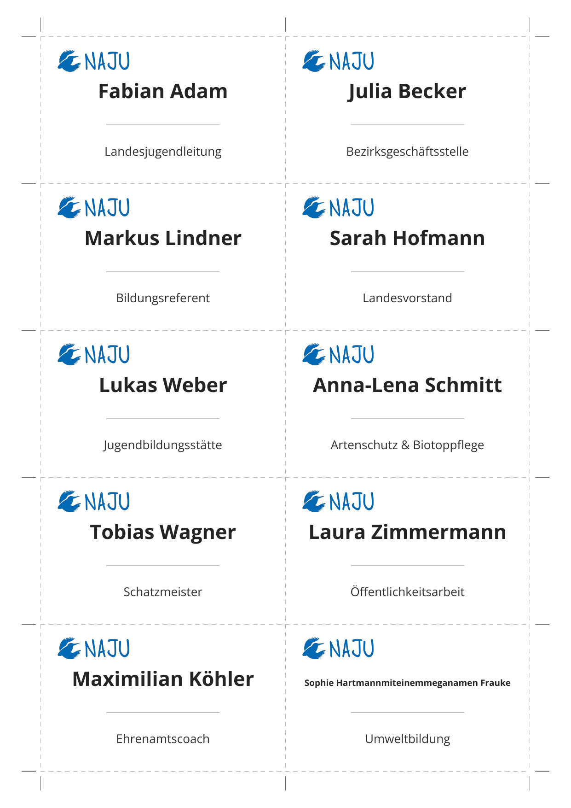

# Namensschilder-Generator (CSV → DIN A4 PDF)

Generiert automatisch druckfertige Namensschilder im Standardmaß (**90 × 54 mm**, z. B. für Durable/Avery-Halter) aus einer CSV-Datei. Auf ein DIN-A4-Blatt passen **10 Namensschilder (2 × 5 Raster)** inklusive Schnittlinien und äußeren Schnittmarken.

## Beispiel-Ausgabe

<p align="center">
  
</p>

## Installation

Das Skript benötigt lediglich `fpdf2` (reines Python, läuft unter macOS, Windows und Linux):

### Mit [uv](https://docs.astral.sh/uv/) (empfohlen)

```bash
uv venv                             # virtuelle Umgebung in .venv anlegen
source .venv/bin/activate           # aktivieren (Windows: .venv\Scripts\activate)
uv pip install -r requirements.txt  # Abhängigkeiten installieren
```

Alternativ ohne Aktivieren: `uv run --with-requirements requirements.txt python namensschilder.py`

### Mit pip

```bash
python3 -m venv .venv
source .venv/bin/activate
pip install -r requirements.txt
```

## Schnellstart

1. Namen und Funktionen in `data/teilnehmer.csv` eintragen.
2. Skript ausführen:

```bash
python3 namensschilder.py
```

Dadurch wird `out/namensschilder.pdf` erzeugt.

## Ordnerstruktur

```text
namensschilder/
├── namensschilder.py      # Hauptskript (CLI-Einstiegspunkt)
├── src/
│   ├── csv_reader.py      # CSV-Parser & Textumbruch
│   └── renderer.py        # PDF-Generierung & Layout (fpdf2)
├── data/
│   └── teilnehmer.csv     # Eingabedatei mit Namen & Funktionen
├── img/
│   └── Logo_NAJU_ohneSchriftzug_blau.png
└── out/
    └── namensschilder.pdf # Fertig generiertes A4-PDF
```

## Aufbau der CSV-Datei

Trennzeichen (`,` oder `;` aus Excel) sowie Zeichenkodierung (`UTF-8`, `Windows-1252`) werden automatisch erkannt.

```csv
Name,Funktion
Fabian Adam,Landesjugendleitung
Julia Becker,Bezirksgeschäftsstelle
Markus Lindner,Bildungsreferent
```

_Alternativ werden auch getrennte Spalten `Vorname,Nachname,Funktion` unterstützt. Falls eine Funktion zweizeilig dargestellt werden soll, kann in der Spalte ein `|` gesetzt werden (z. B. `Zeile 1 | Zeile 2`)._

## Kommandozeilen-Optionen

```bash
python3 namensschilder.py [OPTIONEN]
```

| Option           | Beschreibung                                                                                       | Standard                                |
| :--------------- | :------------------------------------------------------------------------------------------------- | :-------------------------------------- |
| `-i`, `--input`  | Pfad zur CSV-Datei                                                                                 | `data/teilnehmer.csv`                   |
| `-o`, `--output` | Pfad zur erzeugten PDF-Datei                                                                       | `out/namensschilder.pdf`                |
| `-l`, `--logo`   | Pfad zur Logo-Datei (`.svg`, `.png`, `.jpg`)                                                       | `img/Logo_NAJU_ohneSchriftzug_blau.png` |
| `-f`, `--font`   | Schriftart (z. B. `Open Sans`, `Arial`, `Verdana`, `Helvetica`)                                    | `Open Sans`                             |
| `--no-logo`      | Namensschilder ohne Logo erstellen                                                                 | –                                       |
| `--no-pronouns`   | Schreiblinie für Pronomen unter dem Namen ausblenden                                                      | –                                       |
| `--no-fill-blank` | Restliche Plätze auf der letzten Seite komplett leer lassen (statt Blanko-Schilder mit Schreiblinien)     | –                                       |
| `--width`         | Breite eines Schildes in mm                                                                               | `90`                                    |
| `--height`        | Höhe eines Schildes in mm                                                                                 | `54`                                    |

### Beispiele

```bash
# Eigene CSV-Datei und eigenes Logo verwenden
python3 namensschilder.py -i liste.csv -o druckbogen.pdf --logo verband_logo.png

# Restliche Plätze auf dem letzten Bogen komplett weiß lassen (ohne Schreiblinien/Logo)
python3 namensschilder.py --no-fill-blank
```

## Druckhinweis

Beim Ausdrucken im PDF-Viewer unbedingt **„Tatsächliche Größe“** bzw. **„Skalierung: 100 %“** (nicht _„An Seite anpassen“_) auswählen, damit die Schilder exakt **90 × 54 mm** groß sind. Durch das aneinandergrenzende Raster reichen **3 vertikale** und **6 horizontale** Schnitte für alle 10 Schilder eines Bogens.
